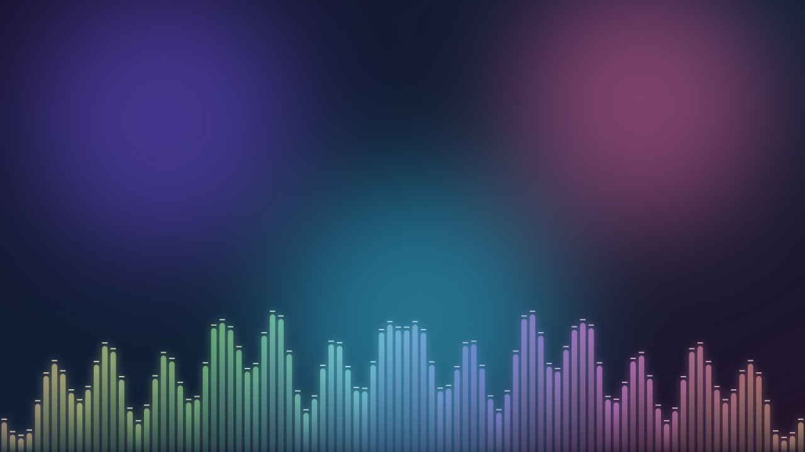
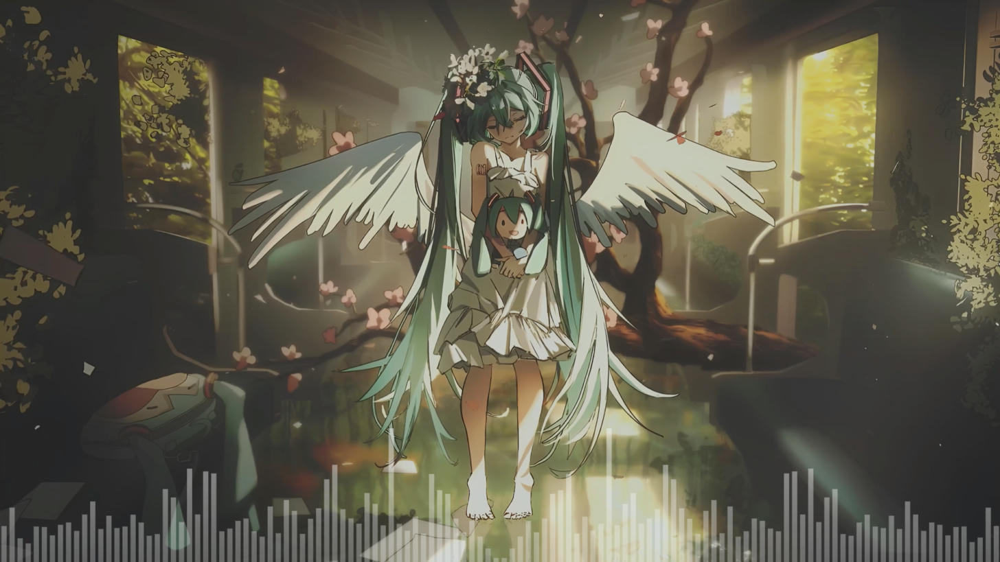
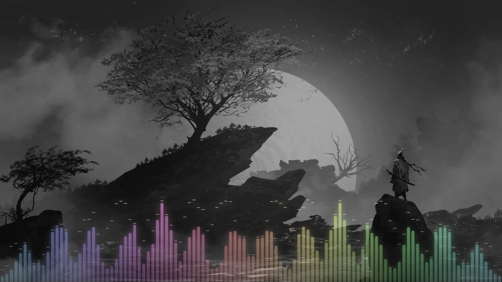

# 🎵 Barras RGB — Fondo de pantalla animado con música

Fondo de pantalla animado con **barras de música RGB en tonos pastel y translúcidas** en la parte de abajo del escritorio, al estilo de los escritorios de Linux. Las barras **se mueven con la música que suena en tu PC** (Spotify, YouTube, Apple Music, juegos…), y detrás puedes poner **tu propia imagen o video**.

## 📸 Capturas

**En el escritorio** (Lively, con video de fondo y barras en blanco):

**Con colores RGB pastel y otro video de fondo:**

## 🎬 Video de muestra

https://github.com/Nermago/barras-rgb-wallpaper/raw/main/capturas/demo.mp4

> Si el video no se ve arriba, [descárgalo aquí](capturas/demo.mp4).

---

## ⬇️ Descarga

Ve a **[Releases](../../releases)** y descarga `BarrasRGB.zip`.

## 🖥️ Instalación

### Lively Wallpaper (gratis) — recomendado
1. Abre Lively Wallpaper.
2. **Arrastra `BarrasRGB.zip`** a la ventana de Lively (o usa el botón **+** y elige el zip).
3. Selecciónalo como fondo. ¡Listo! Pon música y las barras empezarán a moverse.

### Wallpaper Engine (Steam, de pago)
1. Descomprime `BarrasRGB.zip`.
2. Copia la carpeta en:
   `...\Steam\steamapps\common\wallpaper_engine\projects\myprojects\`
3. Abre Wallpaper Engine: el fondo aparece en tu lista. Selecciónalo.

### Otras apps que aceptan fondos web (HTML)
El fondo se puede abrir en cualquier app que muestre páginas web como fondo de escritorio (elige el archivo `index.html`).
⚠️ Las barras **solo reaccionan a la música en Lively y Wallpaper Engine**, porque son las que le pasan el audio del PC al fondo. En otras apps se verá el fondo con una onda suave.

---

## 🎨 Personalización

**Lively:** clic derecho sobre el fondo → **Personalizar**.
**Wallpaper Engine:** selecciona el fondo y usa el panel de la derecha.

| Opción | Qué hace |
|---|---|
| **Tipo de fondo** | Imagen, Video o Degradado animado |
| **Imagen de fondo / Video de fondo** | Elige tu propia imagen (`.jpg`, `.png`, `.webp`, `.gif`) o video (`.mp4`, `.webm`) |
| **Audio del video / Volumen** | Activa el sonido del video de fondo y ajusta su volumen (apagado por defecto) |
| **Oscurecer fondo** | Oscurece la imagen/video para que las barras resalten |
| **Desenfoque del fondo** | Desenfoca la imagen/video |
| **Cantidad de barras** | De 16 a 200 barras |
| **Altura máxima** | Qué tan altas pueden llegar las barras |
| **Separación entre barras** | Espacio entre una barra y otra |
| **Opacidad de las barras** | Más bajo = más transparentes |
| **Saturación / Claridad del color** | Claridad alta = tonos pastel clarito; baja = colores más intensos |
| **Velocidad del arcoíris** | Qué tan rápido cambian los colores (0 = fijos) |
| **Brillo (glow)** | Resplandor alrededor de las barras |
| **Sensibilidad al audio** | Súbela si las barras se mueven poco con tu música |
| **Suavizado de caída** | Qué tan lento bajan las barras |
| **Modo espejo** | Los graves en el centro y los agudos a los lados |
| **Picos que caen** | Rayitas encima de cada barra que caen despacio |
| **Puntas redondeadas** | Barras con la punta redonda o recta |
| **Onda suave sin música** | Una onda leve cuando no suena nada |

## ❓ Problemas comunes

- **Las barras no se mueven:** asegúrate de que la música suene por los altavoces/audífonos predeterminados de Windows y sube la **Sensibilidad al audio**.
- **Mi video no se ve o va lento:** usa formato `.mp4` (H.264) o `.webm`. Los videos de celular suelen estar en HEVC/H.265, que Windows no siempre puede reproducir en fondos web; conviértelos a H.264 (por ejemplo con HandBrake, gratis). Videos 4K a 60 fps también pueden ir pesados en PCs modestas.
- **Consume mucha batería/CPU:** baja la **Cantidad de barras** o el **Brillo (glow)**.

---

## 📄 Licencia

[MIT](LICENSE) — puedes usarlo y modificarlo libremente mencionando al autor.

Hecho con ❤️ por **Abner**.
